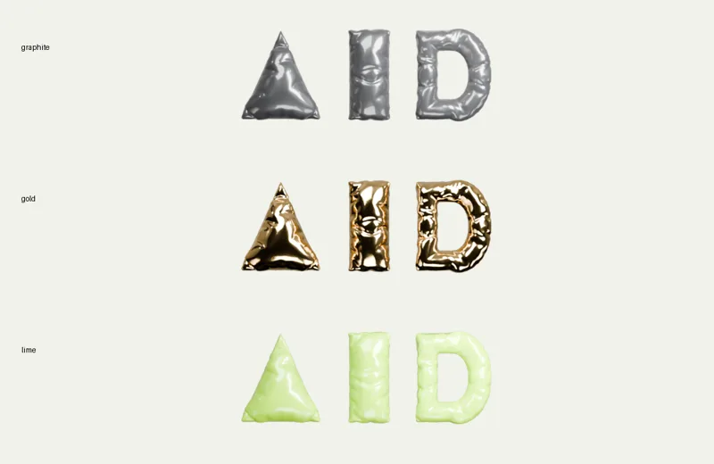

# Blender-студия для агента

Из SVG, логотипа или вектора — объёмный предмет, материалы, студийный свет,
прозрачные рендеры и стадии анимации. Для Claude Code, Codex, Cursor, Hermes,
OpenClaw и Korra с доступом к терминалу.

Фольга со швом, мягкий латекс или экструзия с фаской. Семь материалов.
Три шаблона живого первого экрана: «Чернила», «Лак» и «Вдох».

[Инструкция для агента](SKILL.md) · [Страница в библиотеке Korra](https://korra-agent.online/library/agent-blender-studio/) · [Живой пример команды Korra](https://korra-agent.online/)

Перед установкой из GitHub проверьте, что папка навыка уже опубликована.
Для локальной проверки скопируйте папку навыка в каталог skills вашего агента
и передайте ему SKILL.md. Установка и загрузка во всех шести агентах пока
не проверены; Blender-пайплайн и шаблоны проверяются отдельно.

Требуются Blender 5.2.2, Python 3.12+ и Pillow для упаковки. Платные API и ключи
не нужны. Linux x86_64: есть портативный установщик в пользовательский каталог без прав администратора; для macOS/Windows
Blender устанавливается отдельно. Рендер работает на CPU, GPU необязателен.

Код — MIT; уведомление Pavel Dobryakov сохранено в web/fluid-LICENSE.txt.
Blender (GPL) и HDRI Poly Haven (CC0) скачиваются отдельно. Большие .blend,
мастер-рендеры и пользовательские исходники не входят в пакет.
