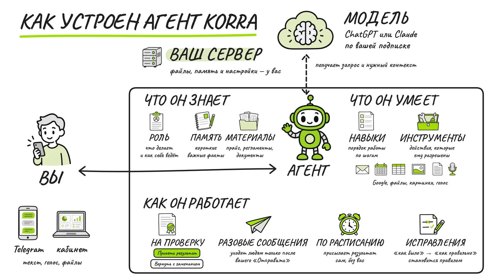

# Рисованная объяснялка

Ролик, где рука с маркером рисует доску по частям, а камера переходит между
ними и в конце показывает схему целиком. MP4 16:9, без звука. Для Claude Code,
Codex, Cursor, Hermes, OpenClaw и Korra с доступом к терминалу.

Объясните устройство продукта, сервиса или процесса: агент собирает сценарий,
иллюстрации в одном стиле, доску с подписями и рендерит ролик. Пример в
комплекте — «Как устроен агент Korra», 92 секунды.

[Инструкция для агента](SKILL.md) · [Формат доски](references/board.md) · [Страница и ролик в Korra Hub](https://korra-agent.online/library/whiteboard-explainer/)

Нужны Python 3.10+, ffmpeg и Chromium для Playwright; зависимости — в
`requirements.txt`. Платные API и ключи не нужны: иллюстрации делает генератор
картинок, который уже есть у агента. Например, Codex с подпиской ChatGPT или
инструмент картинок Korra. Рисование и кодирование идут на CPU, около минуты
на минуту ролика. Проверено на Linux x86_64.

Код — MIT. Движок рисования — [whiteboard-animator](https://github.com/masihsultani/whiteboard-animator)
(MIT), ставится из PyPI вместе с моделью CRAFT. Шрифт Caveat — SIL OFL 1.1,
лицензия в `examples/korra-agent/assets/fonts/`. Иконки и рука примера
сгенерированы для Korra; используйте их как образец стиля.
